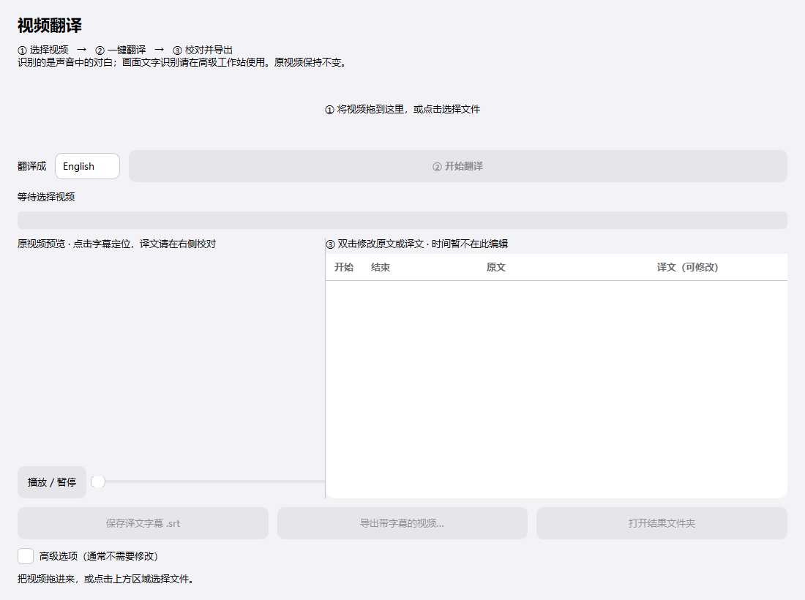

# 视频翻译

Windows 本地字幕工具。在 LocalVideoAI 现有引擎上改进操作流程，默认只显示一个入口：

**选择视频 → 选择目标语言 → 开始翻译 → 校对字幕 → 导出。**



## 使用

本机构建后双击根目录的 `启动视频翻译.cmd`。原来复制的 `LocalVideoAI/` 是旧版备份，不是新版入口。

1. 拖入视频或点击选择。默认自动识别对白语言，可翻译成中文、英语或日语。
2. 点击「开始翻译」，自动识别声音中的对白，再翻译字幕。
3. 完成后双击表格中的原文或译文进行修改。点击字幕可定位原视频。
4. 选择「保存译文字幕 .srt」，或「导出带字幕的视频」。

默认不会遮挡原画面。高级选项中的马赛克只遮挡固定底部区域，可能遮住人物，使用前会再次确认。这不是无痕去字幕。

「当前步骤完成后停止」不是立即中断：当前识别或翻译完成后停止后续步骤。处理过程中不能换文件、修改字幕或打开高级工作站。

自动字幕备份位于视频旁的 `视频名_翻译结果/时间戳/`。导出时可另选路径。原视频不覆盖。修改原文会清空该句旧译文；切换目标语言会先备份旧译文，再生成新语言。缺少译文时不能导出。

## 开发

使用 Python 3.11 或更高版本，建议 Windows + Python 3.12：

```powershell
python -m venv .venv
.\.venv\Scripts\python.exe -m pip install -e ".[dev]"
$env:PYTHONPATH = "$PWD\src"
.\.venv\Scripts\python.exe -m simplecaption
```

模型不在源码仓库中。将已有语音及翻译模型放进 `models/`，或通过 `LOCALVIDEOAI_MODELS_DIR` 指定模型根目录。可从高级工作站的模型管理页导入模型。完整离线运行需要事先准备权重；无法保证所有模型在线下载地址可用。

基础引导流程回归测试（不需要模型权重，视频导出测试使用 FFmpeg）：

```powershell
.\.venv\Scripts\python.exe -m pytest tests/test_guided_workflow.py tests/test_cuda_language_route.py
```

旧测试中部分用例依赖本机模型和生成的媒体夹具，不代表在干净环境中可直接全量通过。

## 打包

```powershell
.\.venv\Scripts\python.exe -m pip install pyinstaller
$env:PYTHONPATH = "$PWD\src"
.\.venv\Scripts\python.exe scripts/prepare_ffmpeg.py
.\.venv\Scripts\python.exe -m PyInstaller --noconfirm --distpath release --workpath build/guided packaging/localvideoai.spec
```

输出为 `release/LocalVideoAI/LocalVideoAI.exe`，必须保留同目录运行库，不能单独复制 EXE。发布包不含模型权重。

## 当前限制

- 默认流程识别的是对白声音，不是画面中的文字；OCR、时间轴和批处理保留在高级工作站。
- 预览显示原视频，不能代表最终烧录字幕效果；导出后检查成片。
- 翻译效果依赖本地模型，界面改版没有升级翻译模型。
- 马赛克导出继承旧编码器选择机制，NVENC 不可用时可能失败；默认普通字幕视频使用 CPU H.264。
- 高级工作站保留旧有功能，本轮没有对所有高级功能做重新验收。

## GitHub 发布准备

本仓库只上传源码、配置模板、测试和说明。模型、安装包、旧程序、日志、缓存、数据库和个人视频已配置忽略。

完整公开发布前仍需确认第三方库、模型及 FFmpeg 的再分发条件。尚未替项目作者选择开源许可证；公开仓库不等于已授予开源许可。详见 `docs/GITHUB_PREPARATION.md`。
